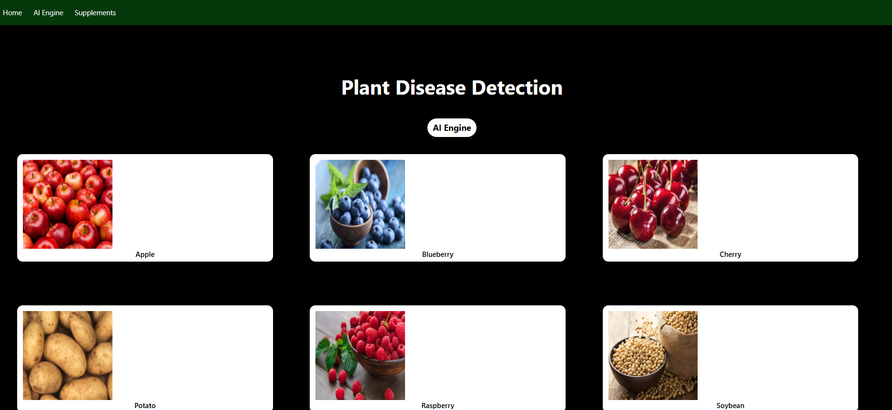
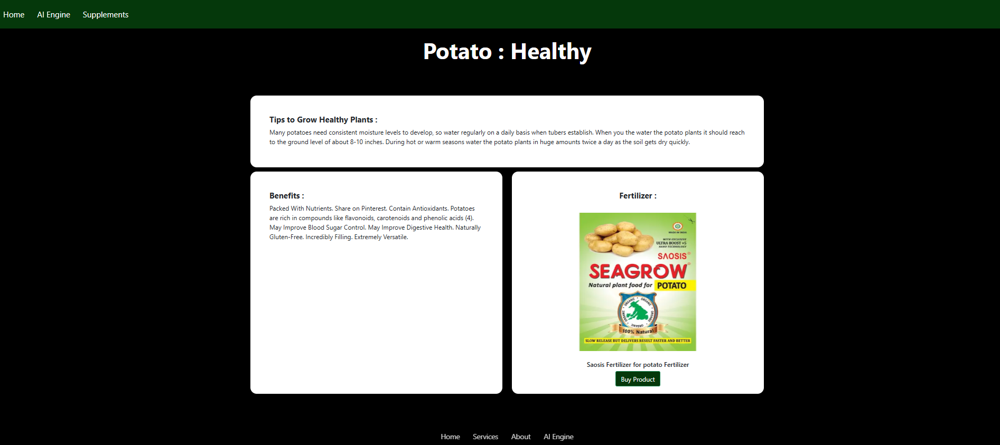
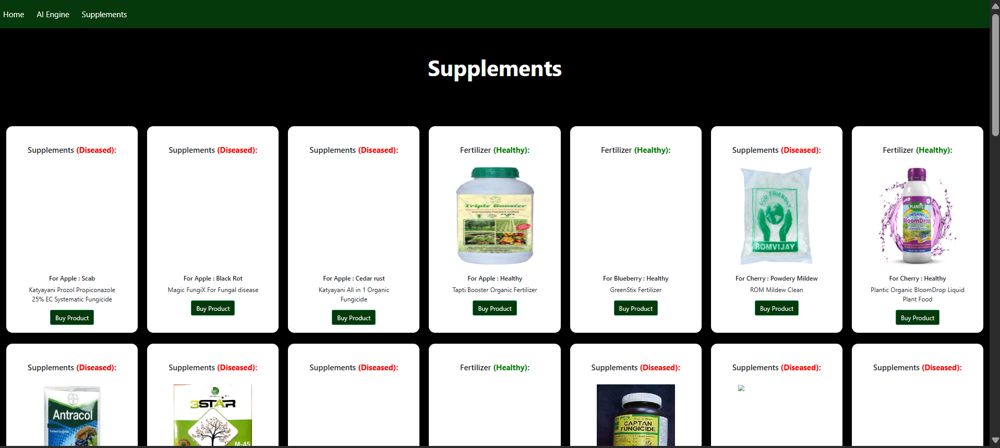

# 🌿 Crop Disease Detection Using Deep Learning

### An AI-powered approach to identifying plant diseases from leaf images

## About the Project

Agriculture plays an important role in food security, and plant diseases can significantly affect crop health and productivity. Identifying diseases at an early stage can help farmers take timely action and reduce potential crop losses.

**Crop Disease Detection** is a deep learning project that explores how computer vision can help identify plant diseases from leaf images. The application allows users to upload an image of a plant leaf and receive a predicted disease category through a simple web interface.

I developed this project to explore the practical application of artificial intelligence in agriculture, particularly image classification using Convolutional Neural Networks (CNNs). It combines a trained deep learning model with a Flask-based web application, bringing together machine learning, image preprocessing, backend development, and user interaction in one system.

## What Does the Application Do?

The application provides the following functionality:

- **Leaf Image Upload:** Users can upload images of plant leaves through the web interface.
- **Image Preprocessing:** Uploaded images are converted to RGB and resized and cropped to match the input format expected by the trained model.
- **Disease Classification:** A trained PyTorch CNN analyzes the image and predicts one of the model's supported plant health or disease categories.
- **Disease Information:** The application integrates disease-related information, including descriptions and prevention guidance, using structured CSV files.
- **Web-Based Interface:** Flask connects the machine learning model to the frontend, allowing users to interact with the system without running model inference manually.

The project also includes sample images for testing the application's prediction workflow.

## How It Works

The application follows a straightforward image-classification pipeline:

1. The user uploads a plant leaf image.
2. The image is opened, converted to RGB, and preprocessed to the dimensions expected by the model.
3. The preprocessed image is passed to the trained CNN implemented in PyTorch.
4. The model produces scores for its supported classes, and the class with the highest score is selected as the prediction.
5. The predicted class is used to retrieve relevant disease information from the project's data files.
6. Flask renders the result through the web interface.

This pipeline connects a trained machine learning model to a practical application, demonstrating how an AI model can be integrated into a usable software system.


## Application Screenshots

### Homepage


### Leaf Disease Prediction


### Supplements store


## Technology Stack
Python - Core programming language 
PyTorch - Deep learning model implementation and inference 
Convolutional Neural Network (CNN)- Plant leaf image classification 
Flask - Backend application and routing 
HTML and CSS - Web interface 
Pandas / CSV files - Structured disease information and recommendations 
Pillow (PIL) - Image loading and processing 
TorchVision - Image preprocessing and transformations 

## Project Structure

The main components of the project are organized as follows:

```text
CropDiseaseDetection/
│
├── app.py
│   └── Flask application, routing, and prediction workflow
│
├── CNN.py
│   └── CNN architecture
│
├── plant_disease_model_1_latest.pt  # Download separately from GitHub Releases
│
├── test_images/
│   └── Sample images for testing predictions
│
├── templates/
│   └── HTML templates for the web interface
│
├── static/
│   └── CSS, images, and other frontend assets
│
├── requirements.txt
│   └── Project dependencies
│
└── README.md
    └── Project documentation
```


## Getting Started

Follow these steps to run the application locally.


### Prerequisites

Make sure you have the following installed:

- Python
- pip
- Git (optional, for cloning the repository)


### Pretrained Model

The trained CNN model checkpoint is available in the [GitHub Releases](https://github.com/09022004/CropDiseaseDetection/releases/tag/v1.0.0).

Download plant_disease_model_1_latest.pt and place it in the project root directory, alongside app.py and CNN.py, before running the application.


### 1. Clone the repository

```bash
git clone https://github.com/09022004/CropDiseaseDetection.git
cd CropDiseaseDetection
```

### 2. Create a virtual environment

```bash
python -m venv .venv
```

Activate it on Windows:

```bash
.venv\Scripts\activate
```

On macOS or Linux:

```bash
source .venv/bin/activate
```

### 3. Install dependencies

If the repository's dependency file is compatible with your Python version, install its packages using:

```bash
pip install -r requirements.txt
```

If installation fails because of outdated package versions, use compatible versions of PyTorch and TorchVision for your Python environment.

### 4. Run the application

Navigate to the directory containing `app.py` and run:

```bash
python app.py
```

Open the local address printed in the terminal. For a typical Flask development configuration, this is:

```text
http://127.0.0.1:5000
```

Upload a sample leaf image and explore the prediction workflow.

## Model and Implementation

The application uses a Convolutional Neural Network implemented in PyTorch. CNNs are commonly used for image classification because their convolutional layers learn spatial patterns and visual features from images.

The project includes a trained checkpoint containing the model weights used for inference. The application preprocesses uploaded images before passing them to the network, and the predicted class is connected to the corresponding disease information.

The current application supports 39 output categories. The prediction represents the model's most likely class among those categories; it should not be interpreted as a confirmed agricultural diagnosis.

## What I Learned

Working on this project gave me practical experience in several areas of software development and machine learning:

- Implementing and loading a trained deep learning model with PyTorch.
- Understanding image preprocessing and the importance of matching inference transformations to training transformations.
- Connecting machine learning inference to a Flask backend.
- Handling image uploads and integrating model predictions into a web application.
- Organizing disease information using structured data files.
- Debugging the interaction between a model, backend routes, and frontend templates.

One important takeaway was that developing an AI application involves more than building a model. Preprocessing, integration, testing, and reliable handling of user inputs are also essential parts of the system.


**Developed as a personal project exploring deep learning, computer vision, and practical AI application development.**
